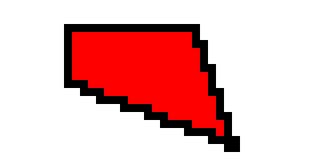

отчёт о лабораторной работе по реализации алгоритма Брезенхема и заливки.

в ходе данной работы был реализован алгоритм Брезенхема для построения отрезка, на основе этого алгоритма была реализована функция построения замкнутой области. Так же были реализованы различные функции заливки.

1.1. алгоритм Брезенхема.

Логика алгоритма:

В основном случае 0≤dy≤dx (первый октант) на каждом шаге из текущего пикселя (xk, yk) выбирается один из двух следующих: E=(xk + 1, yk) или NE = (xk + 1, yk + 1). Критерий выбора — знак значения ошибки Di: если Di<0, то y-прежний, а новая ошибка: Di=D(i-1)+2*dy, в противном случае значение y увеличивается на 1, а новая ошибка: Di=D(i-1)+2*dy-2*dx. Начальная ошибка D0=2*dy-dx. В случае если dy>dx значения xk и yk, а так же dx и dy меняются ролями.

Данный алгоритм реализован на C, пример результата работы:

enter start x and start y:2 2
enter end x and end y:37 16
calls: 36
 0 1 2 3 4 5 6 7 8 910111213141516171819202122232425262728293031323334353637383940
 1 | | | | | | | | | | | | | | | | | | | | | | | | | | | | | | | | | | | | | | | |
 2 |**** | | | | | | | | | | | | | | | | | | | | | | | | | | | | | | | | | | | | |
 3 | | |**** | | | | | | | | | | | | | | | | | | | | | | | | | | | | | | | | | | |
 4 | | | | |****** | | | | | | | | | | | | | | | | | | | | | | | | | | | | | | | |
 5 | | | | | | | |**** | | | | | | | | | | | | | | | | | | | | | | | | | | | | | |
 6 | | | | | | | | | |****** | | | | | | | | | | | | | | | | | | | | | | | | | | |
 7 | | | | | | | | | | | | |**** | | | | | | | | | | | | | | | | | | | | | | | | |
 8 | | | | | | | | | | | | | | |****** | | | | | | | | | | | | | | | | | | | | | |
 9 | | | | | | | | | | | | | | | | | |**** | | | | | | | | | | | | | | | | | | |
10 | | | | | | | | | | | | | | | | | | | |****** | | | | | | | | | | | | | | | | |
11 | | | | | | | | | | | | | | | | | | | | | | |**** | | | | | | | | | | | | | | |
12 | | | | | | | | | | | | | | | | | | | | | | | | |****** | | | | | | | | | | | |
13 | | | | | | | | | | | | | | | | | | | | | | | | | | | |**** | | | | | | | | | |
14 | | | | | | | | | | | | | | | | | | | | | | | | | | | | | |****** | | | | | | |
15 | | | | | | | | | | | | | | | | | | | | | | | | | | | | | | | | |**** | | | | |
16 | | | | | | | | | | | | | | | | | | | | | | | | | | | | | | | | | | |**** | | |
17 | | | | | | | | | | | | | | | | | | | | | | | | | | | | | | | | | | | | | | | |
18 | | | | | | | | | | | | | | | | | | | | | | | | | | | | | | | | | | | | | | | |
19 | | | | | | | | | | | | | | | | | | | | | | | | | | | | | | | | | | | | | | | |
20 | | | | | | | | | | | | | | | | | | | | | | | | | | | | | | | | | | | | | | | |

